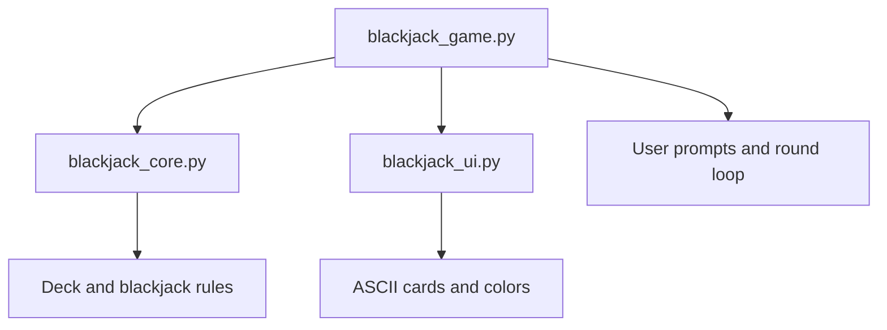

# Blackjack Developer Guide

## Project summary

This project is a console-based blackjack game written in Python. It uses no external libraries and is designed to be easy to read, modify, and extend.

## Module structure

The project is now split into a few focused modules for easier maintenance:

- `blackjack_game.py` contains the session flow, prompts, and round loop.
- `blackjack_core.py` contains the rules engine: card values, deck management, winner logic, and bot decisions.
- `blackjack_ui.py` contains terminal presentation helpers, including colored output and ASCII card rendering.

## Core functions

### `get_card_value(card_rank)`
Returns the numeric value for a rank such as `2`, `J`, or `A`.

### `calculate_hand_value(hand)`
Totals a hand and adjusts Ace values so the total stays valid.

### `Deck`
Creates a shuffled 52-card deck and manages drawing cards.

### `bot_turn(bot_hand, deck, difficulty, dealer_upcard=None)`
Controls the bot's decision-making logic based on the selected difficulty. In hard mode it can use a dealer-aware strategy decision to evaluate the visible card before deciding whether to hit or stand.

### `basic_strategy_decision(hand, dealer_upcard)`
Returns a simple dealer-aware blackjack move decision. It checks the bot's current total and the visible upcard to make a more informed play than a fixed threshold rule.

### `determine_winner(player_total, bot_total)`
Evaluates the result of the round using standard blackjack rules.

### `format_hand(hand, hide_first=False)`
Formats a hand as a multiline ASCII card layout for the terminal. Hidden cards are shown as a covered card placeholder.

### `play_round(round_number, difficulty)`
Runs one full round: deal cards, let the user act, reveal the bot, determine the winner, and print the result.

### `main()`
Sets up the session settings once, then runs the requested number of rounds and prints the final score summary.

## Difficulty design

The three difficulties are intentionally simple and readable:

- Easy: lower-risk behavior.
- Medium: fixed threshold strategy.
- Hard: more aggressive play and a dealer-aware basic strategy model.

The hard mode now uses `basic_strategy_decision`, which considers both the bot's hand and the visible dealer card before deciding to hit or stand. This gives the bot a stronger and more realistic decision pattern than a simple numeric threshold.

## Visual presentation

The game now includes terminal-friendly visual polish:

- ANSI color output for menu text and summaries.
- ASCII card blocks to show each card in a compact, readable layout.
- A hidden-card display for the bot before the reveal stage.

This is handled in `blackjack_ui.py`, so the visual styling can be adjusted independently from the game logic.

## Module interaction



## Suggested enhancements

- Add betting and bankroll management.
- Add split and double-down rules.
- Expand the strategy model toward a fuller basic-strategy table, including soft hands, pairs, and dealer-specific decisions.
- Add card animations or richer terminal art.
- Add a scoreboard file or persistent session history.

## Verification

Run the script in a terminal and test the flow with sample input. A basic check looks like this:

```bash
python .\test\blackjack_game.py
```

Then provide:

- a difficulty choice
- a round count
- `h` or `s` inputs while playing

The output should show the session summary and final score after the selected number of rounds, along with the ASCII card display.
